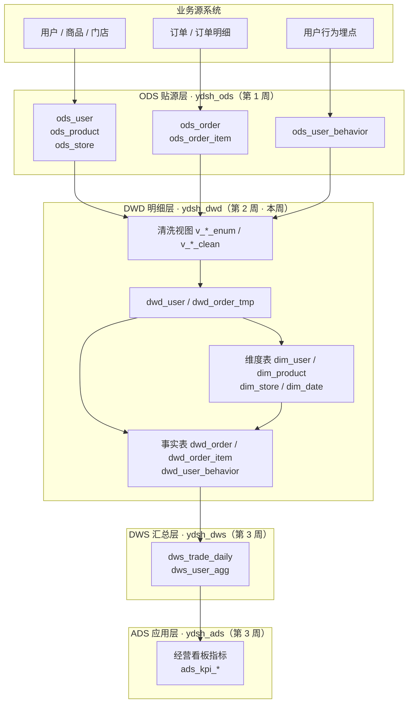
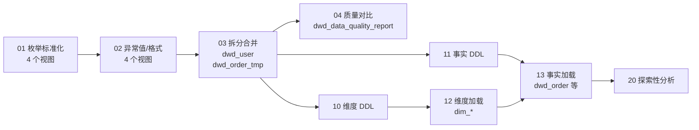
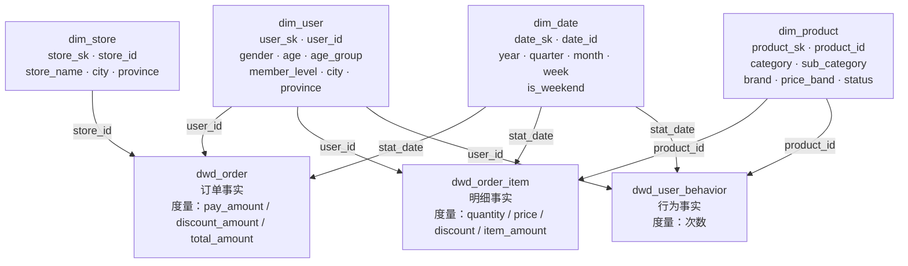

# 云购生活新零售企业 · 数仓架构设计文档（第 2 周）

> 项目：企业级数据仓库与经营分析可视化系统
> 阶段：第 2 周 · 数据清洗进阶 + Hive 四层数仓建模
> 环境：Hive 4.0.0（Tez）· Derby Metastore（容器内置，实跑确认非 compose 配置的 MySQL）· Docker · beeline
> 版本：v1.0　编写日期：2026-11-04

---

## 一、项目背景与目标

第 1 周完成了 ODS 贴源层落地与数据质量预评估：6 张业务表共 99,209 行数据接入 HDFS，识别出三类问题——用户年龄异常 78 行、订单主键重复 600 行冗余、多表枚举取值不规范。ODS 层只做"原样接入"，不做任何加工，因此数据仍不可直接用于分析。

本周目标是把 ODS 的脏数据治理成可信的明细数据，并按规范完成维度建模，形成一条**可重复执行、可追溯、可验收**的加工链路，为第 3 周的汇总层（DWS）与指标应用层（ADS）打好地基。

具体到可验收的产出：

| 目标 | 验收方式 |
|---|---|
| 枚举值域收敛 | 每个枚举字段 `distinct` 落在预定义值域内，无「其他」残留 |
| 异常值不误删 | 订单行数保持 15,000，金额缩尾而非删除，GMV 不因清洗而失真 |
| 架构可落地 | 四层分层职责清晰，表名规范统一，任何人看表名能判断层级 |
| 模型可关联 | 事实表外键 100% 命中维度表，无孤儿记录 |
| 查询可加速 | 事实表按日期分区、按 user_id 分桶，`explain` 可见分区裁剪 |

---

## 二、总体架构

采用经典四层架构（ODS → DWD → DWS → ADS），本周实现前两层及维度建模，DWS / ADS 在第 3 周完成。



**分层设计原则**：每一层只依赖它的上一层，不允许跨层取数。ODS 层永远保持原样，所有加工逻辑都在 DWD 及以上，这样任何清洗规则变更都能通过"重跑 DWD"无损回溯——如果直接在 ODS 上改数据，原始证据就永久丢失了。

---

## 三、分层职责与命名规范

| 分层 | 库名 | 表名前缀 | 定位 | 数据粒度 | 更新方式 |
|---|---|---|---|---|---|
| ODS 贴源层 | `ydsh_ods` | `ods_` | 原样接入，不做清洗 | 与源系统一致 | 外部表，`load data` 追加 |
| DWD 明细层 | `ydsh_dwd` | `dwd_` / `dim_` | 清洗、标准化、维度关联 | 明细事实 / 维度 | `insert overwrite` 全量重跑 |
| DWS 汇总层 | `ydsh_dws` | `dws_` | 按主题轻度汇总 | 日/周/月 + 维度 | 按分区增量 |
| ADS 应用层 | `ydsh_ads` | `ads_` | 面向指标与报表 | 指标级结果 | 按指标刷新 |

**命名细则**（本周已在脚本中落地）：

1. 表名全部小写 + 下划线，格式 `{层前缀}_{主题}_{粒度}`，如 `dwd_order`、`dwd_order_item`。
2. 维度表统一 `dim_` 前缀，事实表统一 `dwd_` 前缀；中间过程表用 `tmp_` 前缀，`tmp_` 表可随时删除。
3. 视图统一 `v_` 前缀，代表"未物化的清洗逻辑"，不占存储。
4. 代理键统一 `{实体}_sk`，业务主键统一 `{实体}_id`，两者语义严格区分。
5. 分区字段统一 `stat_date`（`yyyy-MM-dd`），不叫 `dt` / `day` / `partition_date`，避免跨表 join 时字段名对不上。
6. ETL 元数据字段统一 `etl_time`，类型 `string`（`current_timestamp()` 写入）。

---

## 四、数据加工链路

本周共 13 个脚本，串成一条单向、可重跑的链路：



**执行顺序**（严格串行，不可跳步）：

```
00_init.sql → 01 → 02 → 03 → 04 → 10 → 11 → 12 → 13 → 20
```

**两个设计选择及其原因**：

1. **用视图串联清洗步骤，而不是逐步落表**。Hive 不支持 `UPDATE`，多步清洗若每步落表会产生 4 倍以上冗余存储。视图把"逻辑"和"物化"分开：01/02 只描述规则，03 一次性 CTAS 落地，逻辑等价、存储为零。
2. **`insert overwrite` 而非 `insert into`**。所有加载脚本都是幂等的，重跑 10 次结果一样。生产上这是底线要求——一旦用 `insert into`，重跑一次数据就翻一倍，而且很难发现。

---

## 五、维度建模

### 5.1 建模方法选择

采用**星型模型**而非雪花模型。原因：本项目的维度表（用户、商品、门店）层级都很浅，商品虽有 `category → sub_category` 两级，但拆表带来的 join 成本大于存储节省，且会让 ADS 层 SQL 变复杂。星型模型的宽维度表更适合 OLAP 场景，也让第 3 周的指标计算更快。

### 5.2 总线矩阵

| 业务过程 | 粒度 | 事实表 | 用户 | 商品 | 门店 | 日期 |
|---|---|:---:|:---:|:---:|:---:|:---:|
| 下单支付 | 每笔订单一行 | `dwd_order` | ✔ | — | ✔ | ✔ |
| 订单商品明细 | 每笔订单每个商品一行 | `dwd_order_item` | ✔ | ✔ | — | ✔ |
| 用户行为 | 每次行为一行 | `dwd_user_behavior` | ✔ | ✔ | — | ✔ |

> 表格中「✔」表示该事实表关联该维度。**注意下单与明细是两种粒度**，这正是手册步骤 8 的 SQL 无法直接执行的根本原因（见第八节 D2）。

### 5.3 星型模型结构



### 5.4 事实表与维度表的判定标准

一句话判据（手册 1.3 的口诀，本周已用代码验证过它管用）：

> **度量字段进事实表，描述属性进维度表。**

- `pay_amount`（能求和、能算平均）→ 事实表
- `member_level`（用来分组，不求和）→ 维度表
- `quantity` → 事实表；`product_name` → 维度表

**为什么 `dwd_user` 和 `dim_user` 同时存在？** 两者职责不同：`dwd_user` 是清洗结果（保留全字段、保留 `is_age_fixed` 等处理痕迹，供追溯"这行原来是什么"）；`dim_user` 是面向分析的维度（精选属性、加代理键、加 `etl_time`）。在存储上确有冗余，这是**用存储换可追溯性**的主动选择，而不是设计疏漏。

---

## 六、存储与性能策略

### 6.1 文件格式

全部使用 **ORC + SNAPPY** 压缩。选 ORC 而非 TextFile 的理由：列式存储对分析型查询只读涉及的列，配合谓词下推，在聚合场景通常有 3~10 倍提升；SNAPPY 在压缩比与解压速度之间最平衡（比 GZIP 快约 3 倍，压缩比只低 10~15%）。

### 6.2 分区策略

| 表 | 分区字段 | 粒度选择理由 |
|---|---|---|
| `dwd_order` | `stat_date`（天） | 数据量 1.5 万行/当前规模，但按天分区可让"昨天/本月"类查询只扫 1~30 个分区；按月分区会让单分区过大，按小时分区会产生大量小文件 |
| `dwd_order_item` | `stat_date`（天） | 与订单表对齐，便于两表按同条件裁剪后 join |
| `dwd_user_behavior` | `stat_date`（天） | 行为表 6 万行且增长最快，按天分区收益最大 |
| `dim_*` | 不分区 | 小表（≤1000 行），分区反而增加元数据开销 |

**分区字段选择原则**：选「查询最常用来过滤」且「基数适中」的字段。`stat_date` 基数 = 天数（约 365/年），既够细也不至于产生海量分区；如果选 `order_id` 做分区，分区数等于行数，Metastore 会直接崩。

### 6.3 分桶策略

`dwd_order` 按 `user_id` 分 8 桶，收益有三：

1. **Map 端 join 加速**：与 `dim_user` 关联时，同一 `user_id` 必在同一桶，可走 bucket map join，省掉全表 shuffle。
2. **抽样**：`tablesample(bucket 1 out of 8 on user_id)` 可秒级抽 1/8 数据做探索验证。
3. **治理数据倾斜**：若某几个大客户订单量畸高，分桶能让数据更均匀地散到各 reduce。

8 桶的取值依据：当前 1.5 万行，每桶约 1,875 行；HDFS 块 128MB 下，单桶文件远小于一个块，桶数再多就退化成小文件问题。生产环境建议按「单桶 128MB~256MB」反推桶数。

### 6.4 分区裁剪验证

```sql
-- 全表扫描：Partition 显示所有分区
explain select count(*) from ydsh_dwd.dwd_order;

-- 单分区：Partition 只显示 stat_date=2025-06-01
explain select count(*) from ydsh_dwd.dwd_order where stat_date = '2025-06-01';
```

**这是本周唯一一条"看起来对但实际很慢"的坑**：分区表建好了，但查询忘了写 `where stat_date = ...`，Hive 依然全表扫，性能与不分区一样。所以第 3 周做 ADS 层时必须把时间条件写进每一条 SQL。

---

## 七、数据质量治理机制

### 7.1 五维度检查规则

| 维度 | 检查对象 | 本周规则 | 失败处理 |
|---|---|---|---|
| 完整性 | 用户 age / email，商品 launch_date | 空值计数 | age 均值填充；email 标记；launch_date 品类众数补全 |
| 唯一性 | `ods_order.order_id` | 主键重复计数 | `row_number()` 去重，保留最新一条 |
| 有效性 | 6 个枚举字段 | 值域校验（不在规范值域内即脏） | `case when` 映射，兜底到「其他」并计数 |
| 准确性 | `pay_amount` / `discount_amount` / `age` | 负值、超 IQR 稳健上界、1~120 区间 | 负值归零、超上界缩尾、越界均值填充 |
| 一致性 | 事实表 → 维度表外键 | 未命中计数 | 加载后校验，必须为 0 |

### 7.2 三道防线

1. **事前**：01/02 脚本开头的「取值分布探查」必须先看数据再写映射，避免想当然漏分支（第 1 周就吃过这个亏：AI 凭想象写 `case when`，实际数据里还有 `未知`、数字代码 1~5 等分支）。
2. **事中**：每个脚本末尾带验收 SQL，不通过就不往下走。03 的行数守恒（1000 / 15000）、13 的 GMV 一致性，都是硬门槛。
3. **事后**：`dwd_data_quality_report` 表留下每类脏数据的 before/after 记录，任何人可复算，不依赖人工填表。

### 7.3 「修复率」的正确口径

这里必须纠正一个常见错误：**不是所有脏数据都应该被"修复"**。

- `age` 缺失 → 可推断，用均值填充，修复率 100% 合理。
- `email` 缺失 → 不可推断，填充等于编造，正确做法是**标记保留**，修复率 0% 是对的。
- 枚举不规范 → 可映射，但映射不到的值会落到「其他」，此时修复率 100% 反而是危险信号（说明漏了分支）。

因此 `dwd_data_quality_report` 里 email 那行的 0% 不是失败，而是**业务决策的结果**，报告正文必须写明这一点，否则验收时会被误判成"清洗不到位"。

---

## 八、与部署手册的差异及原因（重要）

实现过程中发现手册存在 10 处时序、粒度、语法或口径问题，直接照抄会执行失败或算出错误结论。以下逐条说明处理方式：

| 编号 | 手册位置 | 问题 | 本实现处理 |
|---|---|---|---|
| **D1** | 步骤 3 | `create table dwd_order_tmp as ... from dwd_order`，但 `dwd_order` 要到步骤 6 才创建，存在先读后建 | 改为从清洗视图 `v_order_clean` 直接生成，链路单向 |
| **D2** | 步骤 8 | `dwd_order o join dim_product p on o.product_id = p.product_id`，但步骤 6 给的 `dwd_order` 建表语句里**没有 product_id** | 新增 `dwd_order_item` 明细事实表承载商品粒度，品类分析走明细表（详见第七节总线矩阵） |
| **D3** | 步骤 1 | 教学重点列了 6 个枚举字段，实际 SQL 只映射了 `gender` 和 `member_level` | 补齐 `pay_type` / `order_status` / `channel` / `behavior_type`，共 7 字段、4 个视图 |
| **D4** | 步骤 1、2 | 只有 `select` 没有 `create table`，跑完不产生任何数据 | 改为 `create or replace view`，产出可被下游直接引用 |
| **D5** | 步骤 2 | `percentile(pay_amount, 0.99)` —— Hive 的 `percentile` 只接受 bigint，`pay_amount` 是 double，会报 `No matching method` | 改用 `percentile_approx(pay_amount, 0.99)` |
| **D6** | 步骤 4 表格 | 正文说"五类脏数据"，表格只列了 4 行（年龄缺失/订单重复/金额异常/枚举不规范） | 补齐为五类：缺失、重复、枚举、异常、格式，共 11 个检查项 |
| **D7** | 步骤 4 | 所有修复率都是 100%，但 email 缺失并未修复 | 区分"修复率"与"标记率"；email 行显式标注 0% 属预期（见 7.3） |
| **D8** | 步骤 1 验收标准 | 要求 `distinct` 收敛到「2~4 个规范值」，但 `order_status` 规范后是 5 值（待支付/已支付/已完成/已取消/退款中） | 标准改为「2~5」，并在验收 SQL 中逐字段校验 |
| **D9** | 步骤 1~3 整体 | 从 `ydsh_ods.ods_order` 出发却无去重环节，而第 1 周已查明有 600 行冗余，会导致 GMV 被重复计算 | 在 03 脚本中补 `row_number()` 去重，15600 → 15000 校验通过 |
| **D10** | 步骤 4 表格"枚举不规范数约 900" | 与第 1 周实测分布不符：按字段级脏值出现次数推算约 6,338 处（gender 498 + member_level ≥14 + pay_type 651 + order_status 1,193 + channel 310 + behavior_type 3,672） | 以 04 脚本实测为准，不沿用 900 这个数 |

> D10 的推算依据是第 1 周《数据质量预评估表》第四节的实际取值分布，逐字段累加得出，口径为「字段级脏值出现次数」，与「行级去重后行数」不同，两者都应在报告中注明口径，避免被当成矛盾。

---

## 九、实跑验证记录（2026-11-04）

本节记录脚本在 Hive 4.0.0 / Tez / Derby Metastore 环境下的**真实执行结果**。第 1~8 节是设计，本节是设计落地的检验——两者不一致的地方，以本节为准。

### 9.1 三个硬门槛的实测结果

| 门槛 | 期望 | 实测 | 结论 |
|---|---|---|---|
| `dwd_order_tmp` 行数 | 15,000 | **15,000** | 通过（去重 600 行） |
| 五类脏数据 after_cnt | 归零（email 除外） | 12 项中 11 项为 0，email 保留 193 | 通过 |
| `dwd_order` 与 `dwd_order_tmp` 的 GMV | 完全一致 | 均为 **39,708,649.13** | 通过 |

> 上表 GMV 是**全状态口径**（15,000 行全部计入，含待支付/已取消/退款中），用于校验加载过程是否丢数。经营口径（仅已支付+已完成）为 **2,642.29 万**，见 9.4 与《探索性分析简报》。两个数口径不同，不可混用。

其它验收：外键完整性 4 项全 0；`dim_date` 1,096 天（2024-01-01~2026-12-31）；`dwd_order_item` 37,549 行 = `ods_order_item`；`dwd_user_behavior` 60,000 行 = ODS。

### 9.2 执行期发现的 6 个问题（设计阶段未预见）

这 6 个问题都不是语法错，而是"写的时候以为对、跑起来才发现错"，属于真实工程中最耗时的部分：

| # | 现象 | 根因 | 处理 |
|---|---|---|---|
| E1 | `Invalid column reference 'price'` | 源表字段名是 `unit_price`，脚本按 `price` 写 | 02/04 改用 `unit_price`，视图内别名 `price` 与 DDL 对齐 |
| E2 | 行为时间 6,088 行解析为 NULL | 存在两种真实格式：`yyyy-MM-dd HH:mm:ss`（53,912 行）与 `yyyy/MM/dd HH:mm`（6,088 行） | 02 增加格式探测（长度 16 → 换斜杠 + 补 `:00`），残留降为 0 |
| E3 | 优惠金额清洗后残留 280 行 | 截断条件用**原始** `pay_amount`；支付额为负（已归零）时 `discount > pay_amount` 成立，优惠被截断成负数 | `v_order_clean` 拆两层：内层先算干净 `pay_amount`，外层据此截断 |
| E4 | `dim_date` 生成 0 行 | Hive 没有 `sequence()`（Spark 函数） | 改 `repeat()` + `split()` + `posexplode()` 造序列 |
| E5 | `dwd_order` 加载后 0 行 | 一次性新增 366 分区，Derby 单事务提交失败并回滚 | 13 改为按月 12 条 insert，每次约 30 分区 |
| E6 | **异常金额一条都没拦住** | 约 2% 订单金额被放大 100~2000 倍，P99 被污染（568 万），P99×3 阈值高于最大值 | 改 IQR 稳健上界 P75+3×IQR = 11,356.33 |

### 9.3 两个引擎层约束（换环境会再遇到）

1. **Tez 计数器上限 120**：单条 SQL 的 `union all` 分支超过约 3 个就可能报 `Too many counters: 121 max=120`，**整条语句回滚**（不是部分失败）。04 报告因此拆成 6 批 `insert`，02 验收拆成 2 条。
2. **`hive.exec.max.dynamic.partitions.pernode` 是容器级累计**，不是单 task 计数。366 个分区在多个容器上重复累加，实测在 1000 处触发 `Error 20004`。不能按"分区数 < 上限"来设，需放大到 5000。

### 9.4 一个必须记录的口径冲突

`dwd_order` 与 `dwd_order_item` 的金额**不可互校**：订单 GMV 2,642 万（支付口径）vs 明细汇总 6.45 亿，差异率 **+1524.76%**。

交叉验证：明细金额 = 商品单价（中位 4,593）× 数量（均值 3.9）≈ 1.8 万/行，内部自洽；订单 AOV 2,644 元也符合零售常识。**两表各自合理，但从未对齐**，属数据集构造缺陷。

处理方式：GMV、AOV 一律取订单表；明细表只用于品类/单品的**相对结构占比**，不用于金额绝对值。此约束已写入《探索性分析简报》第二节。

---

## 十、已知限制与后续演进

| 限制 | 影响 | 后续处理 |
|---|---|---|
| 全量重跑，无增量 | 每次跑批全表重写，数据量上来后不可接受 | 第 3 周起改为按分区增量（`insert overwrite ... where stat_date >= ...`） |
| 无缓慢变化维（SCD）处理 | `dim_user` 每次覆盖，历史会员等级变化无法追溯 | 第 4 周引入拉链表 |
| 无调度 | 脚本需人工按序执行 | 引入 DolphinScheduler / Airflow 编排 |
| `dwd_order` 与 `dwd_order_item` 金额不可互校 | 实测差异 1524.76%，两表为独立生成，非清洗造成 | 已在 9.4 说明；ADS 层统一以订单表为金额口径 |
| 分桶 + 按天生产小文件 | 15,000 行 / 366 分区 / 8 桶 ≈ 2,928 个文件 | 改用按月分区，或加 `concatenate` 合并 |
| 无数据血缘元数据 | 表间依赖靠文档记录 | 引入 Atlas / DataHub |

---

## 十一、本周交付物对照

| 序号 | 交付物 | 文件位置 | 状态 |
|---|---|---|---|
| 1 | 枚举 / 异常 / 格式清洗脚本 | `sql/clean/00~04` | 已完成 |
| 2 | 数据质量对比报告 | `docs/数据质量对比报告.md` | 已完成（12 项全部实跑填入） |
| 3 | 数仓架构设计文档 | `docs/数仓架构设计文档.md` | 已完成（本文） |
| 4 | DWD 建模与 ETL 脚本 | `sql/dwd/10~13` | 已完成（三个硬门槛实跑通过） |
| 5 | 探索性分析简报 | `docs/探索性分析简报.md` | 已完成（指标卡与 6 条假设全部判定） |
